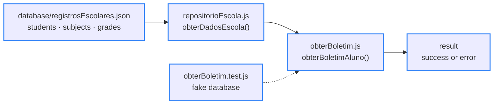
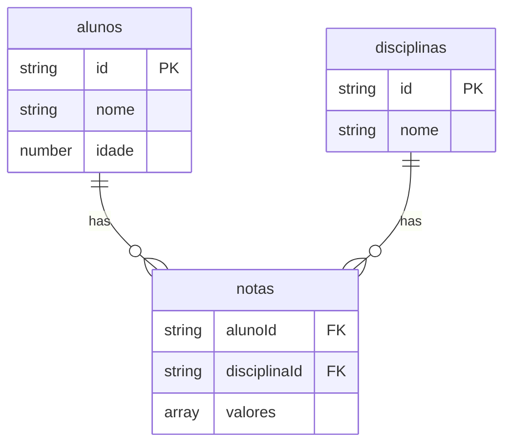

<div align="center">

# 🧩 snippets

> 🌐 Leia em [Português](./README.md)

[](#-the-snippets)

[](#️-technologies-used)

`Pure JavaScript · 0 runtime dependencies · tested with Vitest · ISC`

</div>

Personal collection of JavaScript utility functions, meant to be copied and reused in other projects. Each snippet is self-contained, has no runtime dependencies, and comes with automated tests using [Vitest](https://vitest.dev/).

---

## 📑 Table of Contents

- [🗂️ Project Structure](#️-project-structure)
- [🗂️ Project Structure - tree](#️-project-structure---tree)
- [🧩 The snippets](#-the-snippets)
- [🔄 How it works](#-how-it-works)
- [🗄️ Data model](#️-data-model)
- [🧪 Tests](#-tests)
- [⚙️ Technologies used](#️-technologies-used)
- [🚀 How to run](#-how-to-run)
- [✨ Features](#-features)
- [🤝 Contributing](#-contributing)
- [📄 License](#-license)

---

## 🗂️ Project Structure

| Path | Description |
|---|---|
| `src/array/ordenarCrescente.js` | Takes an array, validates that it only contains integers, and returns the original array along with a copy sorted in ascending order |
| `src/array/ordenarCrescente.test.js` | 6 tests: sorting, immutability of the original array, negative/multi-digit numbers, and the 3 error paths (not an array, non-integer element, blank spot inside the array) |
| `src/string/formatarFrase.js` | Cleans up the sentence (leading/trailing spaces and the invisible U+200B character), capitalizes the first letter, and adds a period when it doesn't end in `!`, `?` or `.`; rejects text longer than 100 characters |
| `src/string/formatarFrase.test.js` | 7 tests: capital letter + period, whitespace cleanup, existing punctuation preserved, rest of the sentence untouched, and the 3 error paths (not text, too long, empty) |
| `src/escola/obterBoletim.js` | `obterBoletimAluno`: takes the school data, the subject (just the beginning of its name is enough) and the student id; returns the average with 2 decimal places and whether the student passed, or one of 5 error codes |
| `src/escola/obterBoletim.test.js` | 11 tests using a fake database in the same shape as the real JSON: passing, failing, exact average, rounding, partial subject search, and the 5 error codes |
| `src/escola/repositorioEscola.js` | The only file that knows where the school data lives: it imports the JSON and exposes `obterDadosEscola()` (Repository pattern) |
| `database/registrosEscolares.json` | Normalized school database: 8 students, 7 subjects and 44 grade records, plus the settings (passing grade and school year) |
| `package.json` | Project metadata and the `npm test` script (Vitest) |
| `package-lock.json` | Lockfile with the exact versions of the dependencies installed by npm |
| `.prettierrc` | [Prettier](https://prettier.io/docs/configuration) configuration — `{}` uses the default rules, so everyone formats the code the same way |
| `.gitignore` | Ignores `node_modules/`, the Code Runner scratch file (`tempCodeRunnerFile.*`), and the test coverage report (`coverage/`) |
| `LICENSE` | ISC license text |
| `README.md` | Portuguese version of this document |
| `README.en.md` | This document, in English |

---

## 🗂️ Project Structure - tree

```
🗂️
├── 📁 database
│  └── 📈 registrosEscolares.json
├── 📁 src
│  ├── 📁 array
│  │  ├── ⚙️ ordenarCrescente.js
│  │  └── 🧪 ordenarCrescente.test.js
│  ├── 📁 escola
│  │  ├── ⚙️ obterBoletim.js
│  │  ├── 🧪 obterBoletim.test.js
│  │  └── ⚙️ repositorioEscola.js
│  └── 📁 string
│     ├── ⚙️ formatarFrase.js
│     └── 🧪 formatarFrase.test.js
├── 🔧 .gitignore
├── 🔧 .prettierrc
├── 🗒️ LICENSE
├── 📦 package-lock.json
├── 📦 package.json
├── 🇺🇸 README.en.md
└── 🇧🇷 README.md
```

---

## 🧩 The snippets

| Snippet | What it does | Returns |
|---|---|---|
| [`ordenarCrescente(vetor)`](./src/array/ordenarCrescente.js) | Sorts an array of integers in ascending order without changing the original | `{ vetorOriginal, ordenadoCrescente }` or `{ erro: "message" }` |
| [`formatarFrase(mensagem)`](./src/string/formatarFrase.js) | Cleans up the sentence, capitalizes the first letter and makes sure it ends with punctuation | `{ sucesso: { novaMensagem, mensagemOriginal } }` or `{ erro: { codigo, mensagem } }` |
| [`obterBoletimAluno(dados, disciplina, idAluno)`](./src/escola/obterBoletim.js) | Calculates the student's average in the subject and says whether they passed | `{ sucesso: { mediaFinal, aprovado, ... } }` or `{ erro: { codigo, mensagem } }` |

No snippet throws an exception: every error comes back as an object. Possible error codes:

- `formatarFrase` → `INVALID_TYPE`, `TOO_LONG`, `EMPTY_MESSAGE`
- `obterBoletimAluno` → `ENTRADA_INVALIDA`, `DISCIPLINA_INVALIDA`, `ID_INVALIDO`, `NOTAS_NAO_ENCONTRADAS`, `ERRO_INTERNO_SERVIDOR`

The catch in `ordenarCrescente`: JavaScript's plain `.sort()` compares numbers as text. The function uses `sort((a, b) => a - b)` on a copy, so it sorts correctly and never touches the array it received.

```text
Input:             [10, -5, 2, 100]
plain .sort():     [-5, 10, 100, 2]   ❌
ordenarCrescente:  [-5, 2, 10, 100]   ✅
```

---

## 🔄 How it works

The `escola` (school) module is split into layers. Only `repositorioEscola.js` knows where the data lives; the report card function receives the data ready-made as a parameter.



<sub>Blue border = done · dashed arrow = the tests call the function directly, without going through the repository</sub>

Swapping the JSON for another database only changes the repository. And since the function receives the data as a parameter, the tests pass in a fake database and don't depend on the real JSON. The search accepts the beginning of the subject name, is case-insensitive, and ignores leading/trailing spaces:

```text
Input:   obterBoletimAluno(obterDadosEscola(), "  MAT ", "01891030")
Output:  disciplina "matematica" · notas [9, 8, 5] · mediaFinal 7.33 · aprovado true
```

---

## 🗄️ Data model



| Item | Detail |
|---|---|
| File | `database/registrosEscolares.json` |
| Coverage | 8 students (`alunos`) · 7 subjects (`disciplinas`) · 44 grade records (`notas`, 3 grades each) |
| Settings | passing grade `7` · school year `2026` |
| Format | Normalized JSON: each student and each subject appears only once, and the `notas` list links the two by their ids |
| Quirks | student ids are strings (`"01891030"`), which keeps the leading zero · not every student takes every subject (44 of 56 combinations); in those cases the report card returns `NOTAS_NAO_ENCONTRADAS` |

---

## 🧪 Tests

```bash
npm install
npm test
```

`npm test` runs in watch mode and reruns the tests whenever a file is saved; `npx vitest run` runs once and exits. There are 24 tests in 3 files:

| File | Tests | Covers |
|---|---|---|
| `ordenarCrescente.test.js` | 6 | sorting, immutability of the original, negative/multi-digit numbers, and the 3 error paths |
| `formatarFrase.test.js` | 7 | capital letter, period, whitespace cleanup, existing punctuation, and the 3 error paths |
| `obterBoletim.test.js` | 11 | passing, failing, exact average, rounding, partial search, and the 5 error codes, using a fake database |

```
 Test Files  3 passed (3)
      Tests  24 passed (24)
```

> ⚠️ Vitest 5's own `package.json` declares `node: ^22.12.0 || ^24.0.0 || >=26.0.0`. On older Node versions (e.g. 18.x), `npm test` fails to even start — this doesn't affect using the snippets directly, only the test suite.

---

## ⚙️ Technologies used

- [JavaScript](https://developer.mozilla.org/docs/Web/JavaScript) (ES6+ / ESM) — implementation language for every snippet, no runtime dependencies
- [Node.js](https://nodejs.org/) — runtime used to run the snippets and the test suite, including the JSON import with [`with { type: "json" }`](https://developer.mozilla.org/docs/Web/JavaScript/Reference/Statements/import/with)
- [Vitest](https://vitest.dev/) — testing framework used in the 3 `.test.js` files
- [Prettier](https://prettier.io/) — code formatting, with the default rules set in `.prettierrc`

---

## 🚀 How to run

Prerequisite: [Node.js](https://nodejs.org/) installed.

```bash
git clone https://github.com/briandevbr/snippets.git
cd snippets
```

The snippets aren't an installable package — the idea is to copy the function into your own project. To quickly try one of them without copying anything, import the file directly in an ESM script. Example with the report card, using the real data:

```bash
node --input-type=module -e "
import obterBoletimAluno from './src/escola/obterBoletim.js';
import { obterDadosEscola } from './src/escola/repositorioEscola.js';
console.log(obterBoletimAluno(obterDadosEscola(), 'matematica', '01891030'));
"
```

Real output:

```
{
  sucesso: {
    anoLetivo: 2026,
    disciplina: 'matematica',
    id: '01891030',
    aluno: 'David',
    idade: 18,
    notas: [ 9, 8, 5 ],
    mediaFinal: 7.33,
    aprovado: true
  }
}
```

If something is wrong, the function doesn't throw — it returns an error object instead. For example, with a subject that doesn't exist:

```
{
  erro: {
    codigo: 'DISCIPLINA_INVALIDA',
    mensagem: 'A disciplina "quimica" não existe no banco de dados.'
  }
}
```

---

## ✨ Features

**Progress: 8 of 9 steps done**

- [x] Folders organized by category (`array`, `string`, `escola`)
- [x] `ordenarCrescente`: checks that the input is an array of integers only and sorts it without changing the original (`sort` runs on a copy)
- [x] `formatarFrase`: capitalized first letter, automatic period, and cleanup of spaces and of the invisible U+200B character
- [x] `obterBoletimAluno`: average with 2 decimal places, pass/fail based on the configured passing grade, and subject search by the beginning of its name
- [x] Returns a descriptive error object instead of throwing an unhandled exception
- [x] Data access isolated in `repositorioEscola.js` (Repository pattern)
- [x] School database normalized into students, subjects and grades
- [x] 24 automated tests with Vitest, one test file per snippet
- [ ] More utility snippets for the collection (planned)

---

## 🤝 Contributing

Personal practice project — no external contribution process at the moment. Suggestions are welcome via [issues](https://github.com/briandevbr/snippets/issues).

---

## 📄 License

[ISC](https://opensource.org/license/isc-license-txt/) — see the [`LICENSE`](./LICENSE) file.

---

<div align="center">
  <sub>Made by <a href="https://github.com/briandevbr">David Brian</a> · part of my personal collection of JS snippets</sub>
</div>
