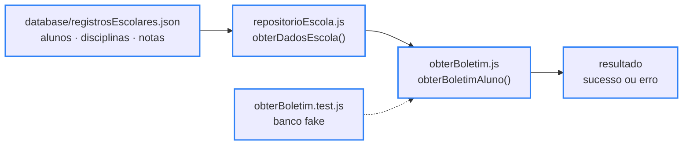
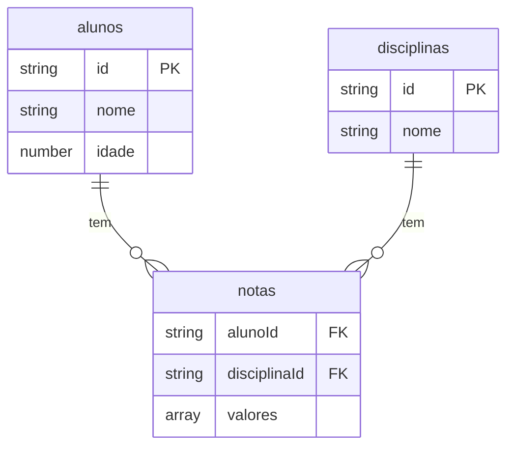

<div align="center">

# 🧩 snippets

> 🌐 Read this in [English](./README.en.md)

[](#-os-snippets)

[](#️-tecnologias-usadas)

`JavaScript puro · 0 dependências de runtime · testes com Vitest · ISC`

</div>

Coleção pessoal de funções JavaScript utilitárias, pensadas para serem copiadas e reaproveitadas em outros projetos. Cada snippet é independente, sem dependências de runtime, e acompanhado de testes automatizados com [Vitest](https://vitest.dev/).

---

## 📑 Sumário

- [🗂️ Estrutura do Projeto](#️-estrutura-do-projeto)
- [🗂️ Estrutura do Projeto - tree](#️-estrutura-do-projeto---tree)
- [🧩 Os snippets](#-os-snippets)
- [🔄 Como funciona](#-como-funciona)
- [🗄️ Modelo de dados](#️-modelo-de-dados)
- [🧪 Testes](#-testes)
- [⚙️ Tecnologias usadas](#️-tecnologias-usadas)
- [🚀 Como rodar](#-como-rodar)
- [✨ Funcionalidades](#-funcionalidades)
- [🤝 Contribuindo](#-contribuindo)
- [📄 Licença](#-licença)

---

## 🗂️ Estrutura do Projeto

| Caminho | Descrição |
|---|---|
| `src/array/ordenarCrescente.js` | Recebe um array, valida se é composto só por inteiros e devolve o array original junto com uma cópia ordenada em ordem crescente |
| `src/array/ordenarCrescente.test.js` | 6 testes: ordenação, imutabilidade do array original, números negativos/de vários dígitos e os 3 caminhos de erro (não é array, elemento não inteiro, posição vazia dentro do array) |
| `src/string/formatarFrase.js` | Limpa a frase (espaços nas pontas e o caractere invisível U+200B), coloca a primeira letra em maiúscula e adiciona ponto final quando ela não termina em `!`, `?` ou `.`; recusa textos acima de 100 caracteres |
| `src/string/formatarFrase.test.js` | 7 testes: maiúscula + ponto final, limpeza de espaços, pontuação existente preservada, resto da frase intacto e os 3 caminhos de erro (não é texto, longo demais, vazio) |
| `src/escola/obterBoletim.js` | `obterBoletimAluno`: recebe os dados da escola, a disciplina (aceita só o começo do nome) e o id do aluno; devolve a média com 2 casas decimais e se o aluno foi aprovado, ou um de 5 códigos de erro |
| `src/escola/obterBoletim.test.js` | 11 testes com um banco fake no mesmo formato do JSON real: aprovação, reprovação, média exata, arredondamento, busca parcial da disciplina e os 5 códigos de erro |
| `src/escola/repositorioEscola.js` | Único arquivo que sabe onde os dados da escola estão: importa o JSON e expõe `obterDadosEscola()` (padrão Repository) |
| `database/registrosEscolares.json` | Base da escola normalizada: 8 alunos, 7 disciplinas e 44 registros de notas, mais a configuração (média de aprovação e ano letivo) |
| `package.json` | Metadados do projeto e script `npm test` (Vitest) |
| `package-lock.json` | Lockfile com as versões exatas das dependências instaladas pelo npm |
| `.prettierrc` | Configuração do [Prettier](https://prettier.io/docs/configuration) — `{}` usa as regras padrão, para todo mundo formatar o código igual |
| `.gitignore` | Ignora `node_modules/`, o arquivo de rascunho do Code Runner (`tempCodeRunnerFile.*`) e o relatório de cobertura (`coverage/`) |
| `LICENSE` | Texto da licença ISC |
| `README.md` | Este documento, em português |
| `README.en.md` | Versão em inglês deste documento |

---

## 🗂️ Estrutura do Projeto - tree

```
🗂️
├── 📁 database
│  └── 📈 registrosEscolares.json
├── 📁 src
│  ├── 📁 array
│  │  ├── ⚙️ ordenarCrescente.js
│  │  └── 🧪 ordenarCrescente.test.js
│  ├── 📁 escola
│  │  ├── ⚙️ obterBoletim.js
│  │  ├── 🧪 obterBoletim.test.js
│  │  └── ⚙️ repositorioEscola.js
│  └── 📁 string
│     ├── ⚙️ formatarFrase.js
│     └── 🧪 formatarFrase.test.js
├── 🔧 .gitignore
├── 🔧 .prettierrc
├── 🗒️ LICENSE
├── 📦 package-lock.json
├── 📦 package.json
├── 🇺🇸 README.en.md
└── 🇧🇷 README.md
```

---

## 🧩 Os snippets

| Snippet | O que faz | Retorno |
|---|---|---|
| [`ordenarCrescente(vetor)`](./src/array/ordenarCrescente.js) | Ordena um array de inteiros em ordem crescente sem alterar o original | `{ vetorOriginal, ordenadoCrescente }` ou `{ erro: "mensagem" }` |
| [`formatarFrase(mensagem)`](./src/string/formatarFrase.js) | Limpa a frase, coloca a primeira letra em maiúscula e garante a pontuação final | `{ sucesso: { novaMensagem, mensagemOriginal } }` ou `{ erro: { codigo, mensagem } }` |
| [`obterBoletimAluno(dados, disciplina, idAluno)`](./src/escola/obterBoletim.js) | Calcula a média do aluno na disciplina e diz se ele foi aprovado | `{ sucesso: { mediaFinal, aprovado, ... } }` ou `{ erro: { codigo, mensagem } }` |

Nenhum snippet lança exceção: todo erro volta como objeto. Códigos de erro possíveis:

- `formatarFrase` → `INVALID_TYPE`, `TOO_LONG`, `EMPTY_MESSAGE`
- `obterBoletimAluno` → `ENTRADA_INVALIDA`, `DISCIPLINA_INVALIDA`, `ID_INVALIDO`, `NOTAS_NAO_ENCONTRADAS`, `ERRO_INTERNO_SERVIDOR`

O detalhe do `ordenarCrescente`: o `.sort()` puro do JavaScript compara os números como texto. A função usa `sort((a, b) => a - b)` sobre uma cópia, então ordena certo e não mexe no array recebido.

```text
Entrada:           [10, -5, 2, 100]
.sort() puro:      [-5, 10, 100, 2]   ❌
ordenarCrescente:  [-5, 2, 10, 100]   ✅
```

---

## 🔄 Como funciona

O módulo `escola` é dividido em camadas. Só o `repositorioEscola.js` sabe onde os dados moram; a função do boletim recebe os dados prontos por parâmetro.



<sub>Borda azul = pronto · seta tracejada = os testes chamam a função direto, sem passar pelo repositório</sub>

Trocar o JSON por outro banco muda só o repositório. E como a função recebe os dados por parâmetro, os testes passam um banco fake e não dependem do JSON real. A busca aceita o começo do nome da disciplina, sem diferenciar maiúscula, e ignora espaços nas pontas:

```text
Entrada:  obterBoletimAluno(obterDadosEscola(), "  MAT ", "01891030")
Saída:    disciplina "matematica" · notas [9, 8, 5] · mediaFinal 7.33 · aprovado true
```

---

## 🗄️ Modelo de dados



| Item | Detalhe |
|---|---|
| Arquivo | `database/registrosEscolares.json` |
| Cobertura | 8 alunos · 7 disciplinas · 44 registros de notas (3 notas cada) |
| Configuração | média de aprovação `7` · ano letivo `2026` |
| Formato | JSON normalizado: cada aluno e cada disciplina aparecem uma vez só, e a lista `notas` liga os dois pelos ids |
| Peculiaridades | ids de aluno são texto (`"01891030"`), o que preserva o zero à esquerda · nem todo aluno cursa todas as disciplinas (44 de 56 combinações); nesses casos o boletim responde `NOTAS_NAO_ENCONTRADAS` |

---

## 🧪 Testes

```bash
npm install
npm test
```

`npm test` roda em modo vigia e repete os testes quando um arquivo é salvo; `npx vitest run` roda uma vez e fecha. São 24 testes em 3 arquivos:

| Arquivo | Testes | Cobre |
|---|---|---|
| `ordenarCrescente.test.js` | 6 | ordenação, imutabilidade do original, negativos/vários dígitos e os 3 caminhos de erro |
| `formatarFrase.test.js` | 7 | maiúscula, ponto final, limpeza de espaços, pontuação existente e os 3 caminhos de erro |
| `obterBoletim.test.js` | 11 | aprovação, reprovação, média exata, arredondamento, busca parcial e os 5 códigos de erro, com banco fake |

```
 Test Files  3 passed (3)
      Tests  24 passed (24)
```

> ⚠️ O Vitest 5 declara em seu `package.json` o requisito `node: ^22.12.0 || ^24.0.0 || >=26.0.0`. Em versões mais antigas do Node (ex.: 18.x), `npm test` falha na inicialização — isso não afeta o uso direto dos snippets, apenas a suíte de testes.

---

## ⚙️ Tecnologias usadas

- [JavaScript](https://developer.mozilla.org/docs/Web/JavaScript) (ES6+ / ESM) — linguagem de implementação de todos os snippets, sem dependências de runtime
- [Node.js](https://nodejs.org/) — runtime usado para rodar os snippets e a suíte de testes, incluindo o import do JSON com [`with { type: "json" }`](https://developer.mozilla.org/docs/Web/JavaScript/Reference/Statements/import/with)
- [Vitest](https://vitest.dev/) — framework de testes usado nos 3 arquivos `.test.js`
- [Prettier](https://prettier.io/) — formatação do código, com as regras padrão definidas em `.prettierrc`

---

## 🚀 Como rodar

Pré-requisito: [Node.js](https://nodejs.org/) instalado.

```bash
git clone https://github.com/briandevbr/snippets.git
cd snippets
```

Os snippets não são um pacote instalável — a ideia é copiar a função para o seu projeto. Para testar um deles rapidamente sem copiar nada, importe o arquivo direto num script ESM. Exemplo com o boletim, usando os dados reais:

```bash
node --input-type=module -e "
import obterBoletimAluno from './src/escola/obterBoletim.js';
import { obterDadosEscola } from './src/escola/repositorioEscola.js';
console.log(obterBoletimAluno(obterDadosEscola(), 'matematica', '01891030'));
"
```

Saída real:

```
{
  sucesso: {
    anoLetivo: 2026,
    disciplina: 'matematica',
    id: '01891030',
    aluno: 'David',
    idade: 18,
    notas: [ 9, 8, 5 ],
    mediaFinal: 7.33,
    aprovado: true
  }
}
```

Se algo estiver errado, a função não lança exceção — ela retorna um objeto de erro. Por exemplo, com uma disciplina que não existe:

```
{
  erro: {
    codigo: 'DISCIPLINA_INVALIDA',
    mensagem: 'A disciplina "quimica" não existe no banco de dados.'
  }
}
```

---

## ✨ Funcionalidades

**Progresso: 8 de 9 etapas concluídas**

- [x] Organização em pastas por categoria (`array`, `string`, `escola`)
- [x] `ordenarCrescente`: valida que a entrada é um array só de inteiros e ordena sem alterar o original (`sort` roda sobre uma cópia)
- [x] `formatarFrase`: maiúscula inicial, ponto final automático e limpeza de espaços e do caractere invisível U+200B
- [x] `obterBoletimAluno`: média com 2 casas decimais, aprovação pela média configurada e busca da disciplina pelo começo do nome
- [x] Retorno de erro descritivo em vez de exceção não tratada
- [x] Acesso aos dados isolado em `repositorioEscola.js` (padrão Repository)
- [x] Base da escola normalizada em alunos, disciplinas e notas
- [x] 24 testes automatizados com Vitest, um arquivo de teste por snippet
- [ ] Novos snippets utilitários da coleção (em planejamento)

---

## 🤝 Contribuindo

Projeto pessoal de treino — sem processo de contribuição externa no momento. Sugestões são bem-vindas via [issues](https://github.com/briandevbr/snippets/issues).

---

## 📄 Licença

[ISC](https://opensource.org/license/isc-license-txt/) — veja o arquivo [`LICENSE`](./LICENSE).

---

<div align="center">
  <sub>Feito por <a href="https://github.com/briandevbr">David Brian</a> · parte da minha coleção pessoal de snippets JS</sub>
</div>
